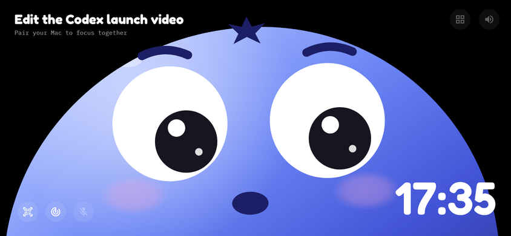

# Bluey for Android

The phone half of Bluey, rebuilt for Android. It does what the iPhone app does: Bluey's face under your
Mac's screen, eyes following your mouse, hold-to-talk voice, the focus timer and timelines, and voice
history. It pairs with the same Mac app using the same QR code and the same encrypted link, so nothing
changes on the Mac.



## What you need

- The Mac app from this repo running on your Mac (see the main [README](../README.md)), with your OpenAI key added.
- An Android phone on Android 8.0 or newer, on the same Wi-Fi as the Mac.
- Google Play services, used for the QR scanner. Without it, you can paste the pairing code instead.

## Install

1. Get `app-release.apk`: build it (below), or download it from the latest **Android APK** GitHub Actions run.
2. Open it on the phone. Android asks you to allow installs from that app (Files, Chrome, Drive…) once.
3. Open Bluey, tap **Pair Mac (scan QR)**, then on the Mac choose **Pair Phone (QR)…** from Bluey's menu and scan it.
4. Allow the microphone the first time you hold his face.

If scanning doesn't work, scan the Mac's QR code with your camera app, copy the `bluey-pair:…` text and paste it into the pairing panel.

## Using it

- Stand the phone sideways under your monitor. The app stays landscape and keeps the screen on.
- **Double tap** his face to wake him or put him back to sleep. **Hold** his face and ask for anything ("open Notes and type hello", "what's on my screen?"), then let go. Or tap the **keyboard** button and type it.
- The top left shows what you asked, what he's doing ("Opening Notes…", "Typing…", "Done", or the Mac's error) and his reply. The ideas at the bottom right send a request when tapped.
- Focus is optional: say what you're about to work on ("I'm editing the video for 30 minutes") or tap the **Focus** button. The timer, pause and end buttons only appear while a session runs.
- The top-right buttons open the chirp volume and Bluey's own screen (voice history, Mac choice).
- Every tool call and its result is logged: `adb logcat -s BlueyVoice`.
- Leaving the app (home button, screen off) pauses focus monitoring and drops the link, like the iPhone app. Resuming is always manual.

## How it differs from the iPhone app

The behaviour and protocol are the same. Under the hood:

| iPhone | Android |
| --- | --- |
| Bonjour (`NWBrowser`) | Android's DNS-SD (`NsdManager`), matching the Mac by the `bluey-id` fingerprint |
| CryptoKit HKDF, HMAC, AES-GCM | `javax.crypto`, checked against RFC test vectors and an independent Python implementation |
| Keychain (this device only) | Pairing secret encrypted with an Android Keystore key; app backups off |
| AVFoundation camera scanner | Google's code scanner (no camera permission needed), or paste the code |
| AVAudioEngine with voice processing | `AudioRecord` voice-communication source (echo cancelling), resampled to 24 kHz |
| SwiftUI Canvas | Compose Canvas, a line-by-line port of the face drawing and animation |

Not ported: the old meeting-audio recorder, which the iPhone app doesn't start by default either.

## Build

Needs JDK 17+ and the Android SDK (Android Studio includes both).

```sh
cd android
./gradlew assembleRelease          # app/build/outputs/apk/release/app-release.apk
./gradlew testDebugUnitTest        # protocol, crypto, focus JSON and audio tests
./gradlew testDebugUnitTest -Pscreenshots   # also renders the screens to app/build/screenshots/
```

Release builds are signed with the debug key unless you add `android/keystore.properties`
(`storeFile`, `storePassword`, `keyAlias`, `keyPassword`; never commit it) or set the matching
`BLUEY_STOREFILE`… environment variables. Android only installs an update over an existing copy if both
are signed with the same key, so uninstall first when switching between builds signed differently.

To check the link against an independent implementation of the Mac's side:

```sh
python3 scripts/mock_mac.py   # prints a port and a pairing code
BLUEY_MOCK_MAC_PORT=<port> BLUEY_MOCK_MAC_QR=<code> ./gradlew testDebugUnitTest --tests '*MockMacInteropTest*'
```

## Privacy

Same as the iPhone app. The phone never sees your OpenAI key: it gets short-lived Realtime tokens from
the Mac. Only speech captured while you hold his face is sent to OpenAI. The pairing secret stays on the
phone, encrypted, and is excluded from backups and device transfers. Focus and voice history are stored in
the app's private storage.
